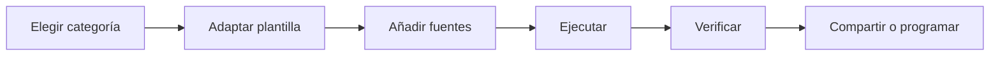

<a id="inicio"></a>

# Catálogo de prompts de alto impacto para Microsoft 365 Copilot

Guía práctica y basada en fuentes oficiales para diseñar, implementar y gobernar prompts en Microsoft 365 Copilot. Incluye **100 plantillas reutilizables**, organizadas en **10 categorías de trabajo**, con instrucciones de implementación.


> [!IMPORTANT]
> Adapte los campos entre corchetes, utilice únicamente fuentes autorizadas y verifique siempre el resultado antes de compartirlo.

> **Alcance.** Este documento trata Microsoft 365 Copilot y Copilot Chat para el trabajo. No cubre GitHub Copilot. La disponibilidad concreta depende de la licencia, el cliente, la región, las políticas del tenant y el despliegue gradual de cada función.[^2][^6]

| Información editorial | Detalle |
|---|---|
| **Audiencia** | Profesionales, responsables de equipo y administradores de Microsoft 365 |
| **Contenido** | 10 categorías · 100 prompts · implementación y gobierno |
| **Propietario recomendado** | Equipo de Productividad Digital, IA o Gestión del Conocimiento |
| **Frecuencia de revisión** | Trimestral o después de cambios relevantes del servicio |
| **Última actualización** | 23 de noviembre de 2026 |

## Navegación principal

| Sección | Acceso directo |
|---|---|
| Cómo usar la biblioteca | [Ruta rápida](#ruta-rápida) · [Sistema OCFE](#sistema-de-prompts-ocfe) · [Sintaxis](#sintaxis-práctica) |
| Categorías 1–5 | [Búsqueda](#categoria-1) · [Escritura](#categoria-2) · [Datos](#categoria-3) · [Presentaciones](#categoria-4) · [Correo](#categoria-5) |
| Categorías 6–10 | [Reuniones](#categoria-6) · [Conocimiento](#categoria-7) · [Encuestas](#categoria-8) · [Documentos](#categoria-9) · [Planificación](#categoria-10) |
| Gobierno | [Implementación](#cómo-implementar-una-biblioteca-de-prompts) · [Seguridad](#seguridad-privacidad-y-revisión-humana) · [Antipatrones](#antipatrones) |
| Automatización recurrente | [24 ideas y plantillas para tareas programadas](intranet/markdown-multipage/13-tareas-programadas.md) |
| Evidencia | [Impacto](#evidencia-de-impacto-interpretación-responsable) · [Fuentes](#fuentes-oficiales) |

## Ruta rápida

1. Elija una categoría según el resultado que necesita.
2. Sustituya los campos entre corchetes: `[proyecto]`, `[archivo]`, `[audiencia]`.
3. Adjunte o referencie únicamente las fuentes necesarias.
4. Ejecute el prompt en la aplicación recomendada.
5. Revise citas, cifras, permisos y conclusiones antes de reutilizar la respuesta.



> [!TIP]
> Para trabajo recurrente, pruebe primero el prompt manualmente y después consulte la guía de tareas programadas.

## Hallazgos principales

- Microsoft propone cuatro componentes para un buen prompt: **objetivo, contexto, fuente y expectativas**.[^1]
- Un objetivo claro es el mínimo; el resto de componentes aumenta precisión y utilidad.[^1]
- La conversación suele ser iterativa: pedir un primer resultado, evaluarlo y continuar con ajustes.[^1][^2]
- El mismo prompt puede producir respuestas diferentes. Las respuestas pueden ser incompletas o incorrectas y deben verificarse.[^1][^3]
- Copilot puede fundamentar respuestas en contenido de Microsoft Graph que el usuario ya tiene permiso para consultar.[^3]
- Microsoft indica que prompts, respuestas y datos accedidos mediante Microsoft Graph no se usan para entrenar los modelos fundacionales de Copilot.[^3]
- No se encontró un límite universal de caracteres aplicable a todas las experiencias. Los límites y capacidades cambian según aplicación y licencia.
- No existe evidencia oficial comparable suficiente para afirmar cuáles son hoy los prompts “más usados”. Este catálogo prioriza escenarios **ampliamente documentados y de alto impacto práctico**, no un ranking de popularidad.

## Sistema de prompts: OCFE

El marco oficial puede recordarse como **OCFE**:

| Componente | Pregunta de diseño | Ejemplo |
|---|---|---|
| **O — Objetivo** | ¿Qué debe hacer Copilot? | “Resume las decisiones…” |
| **C — Contexto** | ¿Para qué, para quién y bajo qué condiciones? | “…para un comité ejecutivo que no participó…” |
| **F — Fuente** | ¿Qué información debe utilizar? | “…usando `/Acta reunión`, el hilo de correo y los archivos adjuntos…” |
| **E — Expectativas** | ¿Cómo debe responder? | “…en una tabla con decisión, responsable, fecha y evidencia.” |

### Plantilla maestra

```text
[OBJETIVO: acción y resultado].

Contexto: [audiencia, finalidad, situación, periodo y restricciones].
Fuentes: [archivos, correos, reuniones, chats, páginas o datos autorizados].
Expectativas: [formato, extensión, tono, criterios de calidad y orden].

Separa hechos, inferencias y datos faltantes. Incluye citas o referencias cuando estén disponibles. No inventes información; indica cualquier incertidumbre que deba revisar una persona.
```

### Sintaxis práctica

Microsoft 365 Copilot no exige un lenguaje formal de programación. La “sintaxis” efectiva es lenguaje natural estructurado:

```text
Verbo + entregable + audiencia + propósito + fuente + periodo + restricciones + formato + control de calidad
```

Ejemplo:

```text
Compara las propuestas de los proveedores para el comité de compras, usando
/Propuesta-A y /Propuesta-B. Evalúa precio, plazo, alcance, riesgos y exclusiones.
Devuelve una matriz comparativa, cita la fuente de cada dato y marca como
“No indicado” cualquier información ausente. No recomiendes una adjudicación.
```

### Referencias y contexto

- Cuando la experiencia lo permita, use `/` o el selector de contexto para referenciar archivos, personas, reuniones u otros recursos.[^2]
- Si una referencia no aparece, adjunte el archivo o comparta un vínculo accesible según las políticas de la organización.
- Copilot solo puede recuperar contenido que el usuario esté autorizado a consultar; esto no reemplaza una correcta gestión de permisos.[^3]
- Inicie una conversación nueva cuando cambie de asunto, objetivo o conjunto de fuentes para reducir contaminación de contexto.
- No entregue “todo el repositorio documental” por defecto. Use el conjunto mínimo de fuentes necesario.

## Taxonomía de capacidades de trabajo

| Categoría | Habilidad principal | Superficies recomendadas |
|---|---|---|
| 1. Búsqueda y síntesis | Encontrar, contrastar y resumir | Copilot Chat, Researcher |
| 2. Escritura y edición | Crear, transformar y revisar texto | Word |
| 3. Datos y decisiones | Analizar patrones y explicar resultados | Excel, Analyst |
| 4. Presentaciones | Construir narrativa visual | PowerPoint |
| 5. Correo y calendario | Reducir carga comunicativa | Outlook |
| 6. Reuniones | Recuperar decisiones y acciones | Teams |
| 7. Conocimiento colaborativo | Organizar notas e ideas | OneNote, Loop |
| 8. Encuestas | Diseñar recopilación estructurada | Forms |
| 9. Gestión documental | Consultar y gobernar conocimiento | SharePoint, OneDrive |
| 10. Planificación y automatización | Convertir resultados en ejecución | Planner, Copilot Chat, agentes |

> La taxonomía anterior es una síntesis editorial orientada al trabajo. No es una taxonomía oficial de Microsoft. La Galería de prompts de Microsoft usa agrupaciones más amplias.[^5]

---

<a id="categoria-1"></a>

## 1. Búsqueda, síntesis y puesta al día

**Objetivo:** encontrar información autorizada, comparar fuentes y construir una visión verificable.
**Aplicaciones:** Copilot Chat; Researcher cuando esté disponible.
**Implementación:** conecte fuentes concretas, delimite periodo y solicite citas. No confunda una síntesis con evidencia primaria.

<details open>
<summary><strong>Ver los 10 prompts de búsqueda y síntesis</strong></summary>

| # | Contenido del prompt | Cómo implementarlo |
|---|---|---|
| 1 | **Resumen ejecutivo.** “Resume `[tema o proyecto]` usando `[archivos/correos/chats]` del periodo `[fecha inicial–fecha final]`. Para `[audiencia]`, presenta: situación actual, decisiones, riesgos, bloqueos y próximos pasos. Incluye una referencia por afirmación y marca cualquier contradicción.” | Copilot Chat. Añada las fuentes con `/` o adjuntos; valide cada cita. |
| 2 | **Puesta al día.** “Ponme al día sobre `[proyecto]` desde `[fecha]`. Revisa mis reuniones, correos, chats y archivos accesibles. Separa novedades, decisiones, acciones asignadas a mí y asuntos sin resolver. No incluyas información anterior salvo que sea necesaria como contexto.” | Copilot Chat con grounding de trabajo. Confirme el periodo y los permisos. |
| 3 | **Comparación de fuentes.** “Compara `[fuente A]`, `[fuente B]` y `[fuente C]` respecto de `[pregunta]`. Crea una tabla con coincidencias, diferencias, fecha de cada evidencia, nivel de confianza y dato faltante. No resuelvas contradicciones sin evidencia.” | Adjunte las tres fuentes. Útil para políticas, propuestas y versiones. |
| 4 | **Cronología.** “Construye una cronología de `[incidente/proyecto/decisión]` entre `[fechas]` usando `[fuentes]`. Para cada evento incluye fecha, actor, acción, resultado y referencia. Señala huecos temporales y fechas inconsistentes.” | Copilot Chat. Revise zona horaria y fechas inferidas. |
| 5 | **Preguntas abiertas.** “Analiza `[documentación]` para identificar qué preguntas siguen sin respuesta sobre `[objetivo]`. Agrupa por alcance, presupuesto, recursos, riesgos y dependencias. Explica por qué cada pregunta importa y a quién debería dirigirse.” | Use antes de una reunión de decisión; no pida respuestas inventadas. |
| 6 | **Mapa de actores.** “A partir de `[correos/reuniones/documentos]`, identifica actores relacionados con `[iniciativa]`, su función explícita, decisiones en las que participaron y acciones pendientes. No infieras actitud, desempeño ni rasgos personales.” | Copilot Chat. Revise nombres y respete restricciones sobre inferencias laborales.[^3] |
| 7 | **Investigación con web.** “Investiga `[tema]` para `[decisión]`. Prioriza fuentes primarias publicadas desde `[fecha]`. Distingue información web de datos internos, cita cada afirmación material y termina con limitaciones y preguntas que requieren validación.” | Researcher o Copilot Chat con web habilitada. Revise las políticas de búsqueda web.[^4] |
| 8 | **Resumen por audiencia.** “Explica `[tema]` usando `[fuentes]` en tres niveles: 50 palabras para dirección, 200 palabras para responsables y una lista técnica para especialistas. Mantén los hechos consistentes y adapta solo profundidad y vocabulario.” | Copilot Chat. Compare las tres versiones para detectar pérdida de matices. |
| 9 | **Detección de cambios.** “Compara la versión `[anterior]` con `[actual]`. Enumera cambios de alcance, obligaciones, fechas, responsables y riesgos. Cita ambas versiones y clasifica cada cambio como añadido, eliminado o modificado.” | Adjunte versiones identificables; confirme que no sean copias duplicadas. |
| 10 | **Brief de decisión.** “Prepara un brief sobre `[decisión]` usando `[fuentes]`. Incluye contexto, opciones documentadas, evidencia a favor y en contra, supuestos, riesgos y datos faltantes. No elijas una opción; formula criterios para que decida `[rol]`.” | Copilot Chat o Researcher. La decisión final corresponde a una persona responsable. |

</details>

[↑ Volver al inicio](#inicio) · [Siguiente categoría: Escritura y edición →](#categoria-2)

<a id="categoria-2"></a>

## 2. Escritura y edición

**Objetivo:** acelerar primeros borradores, reescritura y control editorial.
**Aplicación:** Word.
**Implementación:** seleccione el pasaje cuando quiera editar solo una sección; preserve hechos, términos y citas durante la reescritura.

<details open>
<summary><strong>Ver los 10 prompts de escritura y edición</strong></summary>

| # | Contenido del prompt | Cómo implementarlo |
|---|---|---|
| 1 | **Primer borrador.** “Redacta un primer borrador de `[tipo de documento]` para `[audiencia]` con el objetivo de `[resultado]`, usando `[fuentes]`. Extensión: `[rango]`. Estructura: resumen, contexto, propuesta, riesgos y próximos pasos. Tono: `[tono]`.” | Word. Referencie documentos base y revise toda afirmación antes de publicar. |
| 2 | **Reescritura clara.** “Reescribe el texto seleccionado para un lector `[perfil]`. Conserva significado, cifras, nombres y obligaciones. Reduce jerga y frases pasivas. No agregues hechos. Después, enumera los cambios sustantivos realizados.” | Seleccione el texto en Word y use Copilot sobre la selección. |
| 3 | **Resumen de documento.** “Resume este documento en `[número]` puntos. Para cada punto incluye idea principal, evidencia citada, implicación y acción sugerida. Distingue lo explícito de tus inferencias.” | Word. Use el documento abierto como fuente; valide referencias. |
| 4 | **Documento desde plantilla.** “Completa esta plantilla para `[caso]` usando `[fuentes]`. Respeta títulos, campos obligatorios y orden. Si falta información, escribe `[PENDIENTE: dato necesario]` en vez de inventarla.” | Word con plantilla y fuentes adjuntas. Ideal para formatos repetibles. |
| 5 | **Revisión de coherencia.** “Revisa este documento para detectar contradicciones en fechas, cifras, términos, responsables y conclusiones. Devuelve una tabla con ubicación, inconsistencia, evidencia y corrección propuesta. No cambies el texto todavía.” | Ejecute una fase diagnóstica antes de aceptar cambios. |
| 6 | **Adaptación de tono.** “Adapta el texto seleccionado a un tono `[formal/directo/empático]` para `[audiencia]`. Conserva contenido factual y nivel de compromiso. Evita exageraciones, clichés y promesas no sustentadas.” | Word. Compare original y propuesta, especialmente en textos legales o comerciales. |
| 7 | **FAQ.** “Convierte `[documento]` en una FAQ para `[audiencia]`. Crea 10 preguntas reales, respuestas de máximo `[número]` palabras y una referencia al apartado fuente. No respondas lo que el documento no cubre.” | Word. Revise que cada respuesta sea rastreable. |
| 8 | **Crítica estructural.** “Evalúa la estructura de este documento según claridad del objetivo, orden lógico, evidencia, transiciones y llamada a la acción. Prioriza cinco mejoras y propón un nuevo esquema sin reescribir aún el contenido.” | Word. Aplique después solo las mejoras aceptadas. |
| 9 | **Versión ejecutiva.** “Transforma este informe en una nota ejecutiva de una página. Incluye decisión solicitada, tres hallazgos, impacto, riesgos y siguiente paso. Conserva cifras y añade referencias a las secciones originales.” | Word. Verifique que la compresión no elimine condiciones relevantes. |
| 10 | **Control final.** “Realiza una revisión final de `[documento]`: ortografía, claridad, consistencia terminológica, afirmaciones sin fuente, datos sensibles y acciones ambiguas. Devuelve una lista de correcciones; no edites automáticamente.” | Word. Mantenga aprobación humana antes de distribuir. |

</details>

[← Búsqueda](#categoria-1) · [↑ Inicio](#inicio) · [Datos y decisiones →](#categoria-3)

<a id="categoria-3"></a>

## 3. Análisis de datos y toma de decisiones

**Objetivo:** explorar datos, detectar patrones y explicar resultados sin ocultar supuestos.
**Aplicaciones:** Excel; Analyst cuando esté disponible.
**Implementación:** convierta el rango en tabla, use encabezados claros, documente unidades y no trate correlación como causalidad.

<details open>
<summary><strong>Ver los 10 prompts de datos y decisiones</strong></summary>

| # | Contenido del prompt | Cómo implementarlo |
|---|---|---|
| 1 | **Perfil de datos.** “Analiza la tabla `[nombre]`. Describe columnas, tipos, unidades, valores faltantes, duplicados y posibles errores. No corrijas datos. Entrega un informe de calidad y prioriza los problemas que afectarían `[decisión]`.” | Excel. Revise la tabla antes de cualquier cálculo. |
| 2 | **Tendencias.** “Analiza `[métrica]` por `[periodo/segmento]`. Identifica tendencia, estacionalidad, cambios relevantes y anomalías. Muestra los cálculos utilizados y propone una visualización adecuada.” | Excel o Analyst. Verifique fórmula, escala y periodo. |
| 3 | **Variación contra plan.** “Compara `Real` frente a `Presupuesto` en `[tabla]`. Calcula variación absoluta y porcentual por `[categoría]`, ordena por impacto y explica los principales impulsores respaldados por los datos.” | Excel. Confirme signos, monedas y tratamiento de valores cero. |
| 4 | **Segmentación.** “Segmenta `[clientes/productos/casos]` usando `[variables]`. Describe el criterio, tamaño y rasgos de cada grupo. Evita etiquetas valorativas y no infieras atributos sensibles o no presentes.” | Analyst o Excel. Valide que la segmentación tenga utilidad operativa. |
| 5 | **Anomalías.** “Busca valores atípicos en `[métricas]` durante `[periodo]`. Explica el método, lista los registros afectados y distingue error probable, evento excepcional y variación aún no explicada.” | Excel. Investigue cada anomalía antes de excluirla. |
| 6 | **Escenarios.** “Construye tres escenarios para `[variable de resultado]`: conservador, base y expansivo. Usa `[supuestos]`, muestra fórmulas y sensibilidad a `[variables]`. No presentes proyecciones como predicciones garantizadas.” | Excel. Guarde supuestos en celdas visibles y editables. |
| 7 | **Fórmula explicada.** “Propón una fórmula para calcular `[resultado]` desde `[columnas]`. Explica cada parte, maneja valores vacíos y errores, y muestra tres ejemplos. No modifiques la hoja hasta que confirme.” | Excel. Pruebe en una columna temporal antes de aplicar. |
| 8 | **Panel de indicadores.** “Diseña un panel para `[audiencia]` con `[objetivo]`. Selecciona máximo seis KPI de esta tabla, define cada uno, recomienda gráfico y alerta. Justifica por qué excluyes métricas redundantes.” | Excel. La generación visual puede variar según cliente; valide accesibilidad. |
| 9 | **Comparación de cohortes.** “Compara `[cohorte A]` y `[cohorte B]` en `[métricas]`, controlando `[periodo/segmento]`. Reporta diferencias absolutas y relativas, tamaño de muestra y limitaciones. No atribuyas causalidad.” | Analyst o Excel. Revise sesgos de selección y muestras pequeñas. |
| 10 | **Memo analítico.** “A partir de `[tabla/análisis]`, redacta un memo para `[decisor]` con hallazgos, evidencia, incertidumbre, opciones y preguntas pendientes. Incluye referencias a hojas, tablas o celdas utilizadas.” | Analyst o Copilot Chat con el archivo. Recalcule cifras críticas manualmente. |

</details>

[← Escritura](#categoria-2) · [↑ Inicio](#inicio) · [Presentaciones →](#categoria-4)

<a id="categoria-4"></a>

## 4. Presentaciones y narrativa visual

**Objetivo:** transformar información verificada en una historia clara para una audiencia concreta.
**Aplicación:** PowerPoint.
**Implementación:** use un documento fuente sólido; revise que diseño, cifras y notas no distorsionen la evidencia.

<details open>
<summary><strong>Ver los 10 prompts de presentaciones</strong></summary>

| # | Contenido del prompt | Cómo implementarlo |
|---|---|---|
| 1 | **Presentación desde documento.** “Crea una presentación de `[número]` diapositivas basada en `[documento]` para `[audiencia]`. Objetivo: `[resultado]`. Incluye agenda, narrativa, evidencia, riesgos, recomendación y próximos pasos. Añade notas del presentador y referencias.” | PowerPoint. Use un archivo fuente en OneDrive/SharePoint y revise cada diapositiva. |
| 2 | **Estructura narrativa.** “Propón tres estructuras narrativas para presentar `[tema]` a `[audiencia]`: problema-solución, cronología y opciones-decisión. Para cada una, indica ventajas, riesgos y secuencia de diapositivas.” | PowerPoint o Copilot Chat. Elija estructura antes de generar el deck. |
| 3 | **Resumen del deck.** “Resume esta presentación en: mensaje central, cinco ideas, decisiones solicitadas, riesgos y preguntas previsibles. Señala diapositivas que no apoyan el mensaje central.” | PowerPoint. Útil antes de una revisión ejecutiva. |
| 4 | **Revisión de evidencia.** “Revisa el deck y lista cada cifra o afirmación material con su diapositiva y fuente indicada. Marca como ‘sin fuente’ cualquier elemento no rastreable y propone qué evidencia falta.” | PowerPoint. Corrija fuentes antes de compartir. |
| 5 | **Simplificación.** “Reduce esta presentación de `[actual]` a `[objetivo]` diapositivas para `[duración]` minutos. Conserva decisiones, evidencia y riesgos. Mueve detalle secundario al apéndice y explica qué eliminaste.” | PowerPoint. Revise que no se oculten supuestos esenciales. |
| 6 | **Notas del presentador.** “Genera notas de `[duración]` por diapositiva. Explica el mensaje, transición y evidencia; no leas el texto visible. Marca dónde debo pausar, preguntar o verificar una cifra.” | PowerPoint. Ensaye y ajuste a velocidad real. |
| 7 | **Preguntas difíciles.** “Anticipa 10 preguntas difíciles que `[audiencia]` podría hacer sobre esta presentación. Para cada una, prepara una respuesta basada solo en el deck y señala qué respuesta requiere más datos.” | PowerPoint. No use respuestas sin evidencia. |
| 8 | **Versión por audiencia.** “Adapta esta presentación de `[audiencia original]` a `[nueva audiencia]`. Conserva hechos y decisiones; ajusta profundidad, ejemplos y vocabulario. Lista todos los cambios propuestos antes de aplicarlos.” | PowerPoint. Mantenga una copia original. |
| 9 | **Accesibilidad visual.** “Audita el deck por legibilidad, densidad, contraste, jerarquía, texto alternativo y dependencia exclusiva del color. Prioriza correcciones por impacto y no alteres datos.” | PowerPoint. Complete con el comprobador de accesibilidad nativo. |
| 10 | **Diapositiva de decisión.** “Crea una diapositiva para decidir `[asunto]`: decisión requerida, contexto mínimo, opciones, criterios, riesgos y fecha límite. No recomiendes una opción si las fuentes no la respaldan.” | PowerPoint. Valide la decisión con el propietario del proceso. |

</details>

[← Datos](#categoria-3) · [↑ Inicio](#inicio) · [Correo y calendario →](#categoria-5)

<a id="categoria-5"></a>

## 5. Correo y calendario

**Objetivo:** resumir hilos, redactar mensajes y preparar el trabajo alrededor del calendario.
**Aplicación:** Outlook.
**Implementación:** confirme destinatarios, adjuntos, fechas y compromisos antes de enviar.

<details open>
<summary><strong>Ver los 10 prompts de correo y calendario</strong></summary>

| # | Contenido del prompt | Cómo implementarlo |
|---|---|---|
| 1 | **Resumen de hilo.** “Resume este hilo en: contexto, decisiones, desacuerdos, preguntas abiertas y acciones con responsable y fecha. Cita el mensaje que sustenta cada decisión.” | Outlook. Compare con el hilo antes de actuar. |
| 2 | **Respuesta ejecutiva.** “Redacta una respuesta para `[destinatarios]` que confirme `[decisión]`, responda `[preguntas]` y solicite `[acción]` antes de `[fecha]`. Máximo `[número]` palabras; tono directo y cordial.” | Outlook. Verifique fecha, destinatarios y nivel de compromiso. |
| 3 | **Mensaje difícil.** “Redacta un correo sobre `[problema]` para `[audiencia]`. Expón hechos observables, impacto, acción requerida y canal de seguimiento. Evita culpas, inferencias personales y lenguaje defensivo.” | Outlook. Revisión humana obligatoria en asuntos sensibles. |
| 4 | **Solicitud de decisión.** “Convierte este hilo en una solicitud de decisión. Incluye asunto, decisión requerida, contexto, opciones documentadas, recomendación `[si existe]`, fecha límite y consecuencias de no decidir.” | Outlook. No fabrique opciones ni recomendaciones. |
| 5 | **Seguimiento.** “Redacta un seguimiento de la reunión `[nombre/fecha]`. Resume acuerdos, lista acciones con responsable y fecha, y pide confirmar errores antes de `[plazo]`.” | Outlook. Use notas o recapitulación verificada. |
| 6 | **Preparación del día.** “Resume mi agenda de `[fecha]`. Para cada reunión, incluye objetivo, participantes, material relacionado accesible, decisiones pendientes y preparación recomendada. No infieras información personal.” | Outlook/Copilot Chat. Revise cambios de última hora. |
| 7 | **Priorización de correo.** “Agrupa los correos recibidos desde `[fecha]` en: responder hoy, delegar, leer, esperar y archivar. Para cada uno, explica el criterio y propone la siguiente acción. No envíes ni elimines nada.” | Copilot Chat con correo. El usuario mantiene control de acciones. |
| 8 | **Reprogramación.** “Redacta un mensaje para reprogramar `[reunión]`. Explica brevemente `[motivo]`, ofrece `[opciones]`, reconoce el impacto y confirma qué preparación sigue vigente.” | Outlook. Compruebe disponibilidad real antes de enviar. |
| 9 | **Boletín interno.** “Crea un correo semanal de `[equipo/proyecto]` usando `[fuentes]`. Secciones: logros, métricas, decisiones, riesgos, ayuda necesaria y próximos hitos. Máximo `[número]` palabras.” | Outlook o Word. Revise datos sensibles y listas de distribución. |
| 10 | **Auditoría de tono.** “Evalúa este borrador por claridad, tono, ambigüedad, exceso de compromiso y posibles interpretaciones adversas. Propón una versión corregida y explica los cambios.” | Outlook. Aplique criterio profesional, legal o de RR. HH. cuando corresponda. |

</details>

[← Presentaciones](#categoria-4) · [↑ Inicio](#inicio) · [Reuniones →](#categoria-6)

<a id="categoria-6"></a>

## 6. Reuniones y colaboración

**Objetivo:** ponerse al día, recuperar decisiones y convertir conversación en acciones.
**Aplicación:** Teams.
**Implementación:** la calidad depende de la transcripción y del contenido disponible. Contraste decisiones críticas con participantes o actas.

<details open>
<summary><strong>Ver los 10 prompts de reuniones</strong></summary>

| # | Contenido del prompt | Cómo implementarlo |
|---|---|---|
| 1 | **Recapitulación.** “Resume esta reunión en objetivo, temas, decisiones, desacuerdos, riesgos y próximos pasos. Para cada acción incluye responsable, fecha y evidencia en la transcripción.” | Teams durante o después de la reunión, si la función está disponible. |
| 2 | **Lo que me afecta.** “¿Qué partes de esta reunión afectan a `[mi rol/equipo]`? Lista decisiones, acciones asignadas, dependencias y preguntas que debo aclarar. Cita los momentos relevantes.” | Teams. Verifique asignaciones antes de asumir compromisos. |
| 3 | **Decisiones exactas.** “Enumera únicamente decisiones explícitas de la reunión. Para cada una, indica quién la formuló, quién la confirmó, condiciones, fecha y cita. Separa propuestas no aprobadas.” | Teams. Ideal para evitar confundir ideas con acuerdos. |
| 4 | **Debate por tema.** “Organiza la discusión por `[temas]`. Resume argumentos a favor y en contra sin atribuir emociones ni intenciones. Indica qué evidencia se mencionó y qué quedó pendiente.” | Teams. Respete políticas sobre inferencias laborales.[^3] |
| 5 | **Preguntas sin respuesta.** “Lista todas las preguntas que quedaron sin respuesta. Agrupa por prioridad, propietario probable y dato necesario. No asignes responsables si no fueron acordados.” | Teams. Revise con el organizador. |
| 6 | **Acta formal.** “Convierte la transcripción en un acta con fecha, participantes, agenda, síntesis, acuerdos, acciones y próxima revisión. Marca `[POR CONFIRMAR]` cuando falte evidencia.” | Teams y luego Word. Obtenga aprobación del acta. |
| 7 | **Recuperar una ausencia.** “No asistí a la reunión. Explícame en cinco minutos qué cambió respecto de `[contexto previo]`, qué se decidió, qué debo hacer y qué debo leer. Incluye referencias.” | Teams. La evidencia de 2023 mostró rapidez, pero también ligera pérdida de detalle.[^7] |
| 8 | **Preparar seguimiento.** “Redacta un mensaje de Teams posterior a la reunión con acuerdos, acciones y fechas. Pide correcciones explícitas y mantén el mensaje bajo `[número]` palabras.” | Teams. Publique solo después de verificar. |
| 9 | **Eficacia de reunión.** “Evalúa la reunión por claridad del objetivo, decisiones alcanzadas, acciones, temas fuera de alcance y asuntos que requieren otra sesión. No evalúes desempeño ni actitud de personas.” | Teams. Use para mejorar el proceso, no para calificar empleados. |
| 10 | **Próxima agenda.** “Crea la agenda de seguimiento usando los pendientes de esta reunión. Para cada punto incluye objetivo, propietario acordado, información previa y decisión esperada. Limita la agenda a `[duración]`.” | Teams/Outlook. Confirme propietarios y duración. |

</details>

[← Correo](#categoria-5) · [↑ Inicio](#inicio) · [Conocimiento colaborativo →](#categoria-7)

<a id="categoria-7"></a>

## 7. Captura y organización de conocimiento

**Objetivo:** convertir notas dispersas en conocimiento reutilizable y coordinado.
**Aplicaciones:** OneNote y Loop, según disponibilidad.
**Implementación:** mantenga enlaces a fuentes y propietarios; no permita que un resumen sustituya el documento oficial.

<details open>
<summary><strong>Ver los 10 prompts de conocimiento colaborativo</strong></summary>

| # | Contenido del prompt | Cómo implementarlo |
|---|---|---|
| 1 | **Notas estructuradas.** “Organiza estas notas en objetivos, hechos, ideas, decisiones, preguntas y acciones. No cambies el significado. Marca duplicados y contradicciones.” | OneNote. Revise antes de reemplazar las notas originales. |
| 2 | **Plan desde notas.** “Convierte estas notas sobre `[iniciativa]` en un plan con resultado, alcance, tareas, dependencias, riesgos y próximos pasos. Distingue lo acordado de lo propuesto.” | OneNote o Loop. Confirme decisiones con el equipo. |
| 3 | **Base de conocimiento.** “Transforma `[notas/documentos]` en un artículo de conocimiento para `[audiencia]`: propósito, procedimiento, ejemplos, errores comunes, escalamiento y fuentes.” | OneNote/Loop o Word. Defina propietario y fecha de revisión. |
| 4 | **Glosario.** “Extrae términos, siglas y conceptos de estas páginas. Define cada uno usando solo el contenido disponible, cita la fuente y marca definiciones ambiguas.” | OneNote. Valide con especialistas del dominio. |
| 5 | **Mapa de ideas.** “Agrupa estas ideas por tema, valor esperado, esfuerzo, dependencia y riesgo. No descartes ninguna. Señala ideas duplicadas y preguntas para evaluarlas.” | Loop. Use en talleres de ideación. |
| 6 | **Registro de decisiones.** “Crea un registro con decisión, fecha, contexto, opciones, razonamiento documentado, responsable y revisión futura. Escribe `[NO DOCUMENTADO]` cuando falte información.” | Loop/OneNote. Enlace la fuente original. |
| 7 | **Onboarding.** “Diseña una guía de incorporación para `[rol]` usando estas páginas. Incluye primera semana, recursos, contactos funcionales, procesos y comprobación de aprendizaje.” | OneNote. Verifique accesos y vigencia de enlaces. |
| 8 | **Resumen semanal.** “Resume las actualizaciones de este espacio durante `[periodo]`: contenido nuevo, decisiones, tareas completadas, bloqueos y páginas que necesitan revisión.” | Loop/Copilot Chat. Confirme qué contenido está incluido. |
| 9 | **Limpieza de conocimiento.** “Identifica páginas duplicadas, obsoletas, contradictorias o sin propietario en `[conjunto]`. Propón conservar, combinar, actualizar o archivar; no realices cambios.” | Copilot Chat/OneNote según soporte. Revisión humana antes de archivar. |
| 10 | **Checklist operativo.** “Convierte este procedimiento en una lista de verificación con pasos, responsable, evidencia esperada, condición de finalización y ruta de escalamiento.” | OneNote o Loop. Pruebe el checklist con un caso real. |

</details>

[← Reuniones](#categoria-6) · [↑ Inicio](#inicio) · [Encuestas →](#categoria-8)

<a id="categoria-8"></a>

## 8. Encuestas y recopilación de información

**Objetivo:** diseñar formularios útiles, neutrales y analizables.
**Aplicación:** Forms, cuando las capacidades de Copilot estén disponibles.
**Implementación:** defina objetivo, población y decisión antes de generar preguntas; revise privacidad y sesgo.

<details open>
<summary><strong>Ver los 10 prompts de encuestas</strong></summary>

| # | Contenido del prompt | Cómo implementarlo |
|---|---|---|
| 1 | **Encuesta de satisfacción.** “Crea una encuesta de 10 preguntas para medir `[experiencia]` en `[población]`. Combina escala, opción múltiple y dos preguntas abiertas. Cada pregunta debe apoyar `[decisión]`.” | Forms. Revise longitud, anonimato y tratamiento de datos. |
| 2 | **Diagnóstico de necesidades.** “Diseña un formulario para identificar necesidades de `[formación/proceso]`. Mide frecuencia, impacto, confianza actual y prioridad. Evita preguntas dobles y lenguaje que sugiera la respuesta.” | Forms. Haga un piloto con usuarios reales. |
| 3 | **Registro de evento.** “Crea un formulario de inscripción para `[evento]` con datos mínimos necesarios, preferencias logísticas, accesibilidad, consentimiento y confirmación. Señala qué campos no deberían recopilarse.” | Forms. Aplique minimización de datos y política de privacidad. |
| 4 | **Retrospectiva.** “Genera una encuesta breve para `[proyecto/sprint]`: qué funcionó, qué falló, impacto, aprendizaje y mejora prioritaria. Máximo 5 minutos de respuesta.” | Forms o Teams. No use resultados anónimos para inferir identidades. |
| 5 | **Evaluación de formación.** “Crea preguntas para medir reacción, aprendizaje, aplicación esperada y apoyo necesario tras `[curso]`. Incluye respuestas correctas solo cuando exista una fuente verificable.” | Forms. Separe satisfacción de aprendizaje. |
| 6 | **Sondeo de decisión.** “Diseña un sondeo sobre `[opciones]` que explique cada alternativa de forma equilibrada. Recoge preferencia, criterio principal y nivel de confianza. Evita presentar el resultado como decisión vinculante.” | Forms. Informe de antemano cómo se usará el resultado. |
| 7 | **Auditoría de preguntas.** “Revisa este formulario para detectar sesgo, ambigüedad, preguntas dobles, escalas inconsistentes, datos innecesarios y problemas de accesibilidad. Propón correcciones justificadas.” | Forms/Copilot Chat. Revise con privacidad o cumplimiento si aplica. |
| 8 | **Lógica de ramificación.** “Propón lógica de ramificación para este formulario. Indica condición, destino y motivo de cada salto. Minimiza preguntas irrelevantes y evita rutas sin salida.” | Forms. Pruebe todas las rutas manualmente. |
| 9 | **Plan de análisis.** “Para esta encuesta, crea un plan de análisis que relacione cada pregunta con métrica, segmentación, visualización y decisión. Señala limitaciones de muestra y sesgo.” | Forms/Excel. Defina el plan antes de recopilar respuestas. |
| 10 | **Resumen de resultados.** “Resume las respuestas de `[encuesta]` para `[audiencia]`. Separa datos cuantitativos, temas cualitativos y citas anonimizadas. Incluye tamaño de muestra, periodo y limitaciones.” | Forms exportado a Excel o Analyst. Proteja identidades y grupos pequeños. |

</details>

[← Conocimiento](#categoria-7) · [↑ Inicio](#inicio) · [Gestión documental →](#categoria-9)

<a id="categoria-9"></a>

## 9. Gestión documental y conocimiento corporativo

**Objetivo:** localizar, revisar y gobernar contenido en SharePoint y OneDrive.
**Aplicaciones:** Copilot Chat, SharePoint y OneDrive según licencia.
**Implementación:** Copilot respeta permisos existentes, pero puede amplificar problemas de sobreexposición; revise permisos y etiquetas.[^3]

<details open>
<summary><strong>Ver los 10 prompts de gestión documental</strong></summary>

| # | Contenido del prompt | Cómo implementarlo |
|---|---|---|
| 1 | **Localizar política.** “Encuentra la política vigente sobre `[tema]` en contenido autorizado. Prioriza documentos aprobados y recientes. Devuelve título, propietario, fecha, estado, enlace y pasajes relevantes.” | Copilot Chat. Confirme que “vigente” esté explícito. |
| 2 | **Comparar políticas.** “Compara `[política A]` y `[política B]` por alcance, obligaciones, excepciones, responsables y fechas. Cita secciones exactas y marca contradicciones.” | Adjunte o referencie ambos documentos. Consulte al propietario. |
| 3 | **Inventario temático.** “Crea un inventario de documentos accesibles sobre `[tema]`. Agrupa por tipo, propietario, fecha y estado. Señala duplicados probables y contenido sin fecha de revisión.” | Copilot Chat/SharePoint. No archive automáticamente. |
| 4 | **Revisión de metadatos.** “Analiza `[biblioteca/conjunto]` y propone metadatos para mejorar búsqueda: tipo, área, propietario, vigencia, confidencialidad y tema. Explica reglas y valores permitidos.” | SharePoint. Valide con arquitectura de información. |
| 5 | **Resumen con trazabilidad.** “Resume `[documento]` para `[audiencia]` y enlaza cada conclusión a la sección fuente. Incluye versión, fecha y propietario; no mezcles otras fuentes.” | SharePoint/OneDrive o Copilot Chat. Preserve trazabilidad. |
| 6 | **Contenido obsoleto.** “Identifica contenido potencialmente obsoleto según fecha, referencias rotas, propietario ausente o conflicto con documentos más recientes. Propón una revisión; no elimines nada.” | SharePoint/Copilot Chat. La obsolescencia debe confirmarla el propietario. |
| 7 | **Paquete de proyecto.** “Reúne una lista de los documentos esenciales para incorporar a alguien a `[proyecto]`: propósito, estado, plan, decisiones, riesgos y contactos. Explica por qué incluye cada archivo.” | Copilot Chat. Revise acceso antes de compartir el paquete. |
| 8 | **Preguntas sobre procedimiento.** “Responde `[pregunta]` usando únicamente `[política/procedimiento]`. Cita la sección exacta. Si el documento no responde, dilo y señala a qué propietario consultar.” | Copilot Chat. Adecuado para respuestas rastreables, no asesoría profesional. |
| 9 | **Preparación de auditoría.** “Crea una lista de evidencia disponible para `[control/requisito]`. Para cada elemento incluye ubicación, propietario, periodo y brecha. No declares cumplimiento.” | SharePoint/Copilot Chat. La evaluación formal corresponde a auditoría/compliance. |
| 10 | **Modelo de gobernanza.** “A partir de `[documentación]`, propón un ciclo de vida documental: creación, revisión, aprobación, publicación, actualización y archivo. Asigna roles genéricos y criterios, no personas.” | SharePoint. Aprobación de propietarios, seguridad y cumplimiento. |

</details>

[← Encuestas](#categoria-8) · [↑ Inicio](#inicio) · [Planificación y automatización →](#categoria-10)

<a id="categoria-10"></a>

## 10. Planificación, ejecución y automatización

**Objetivo:** convertir resultados en planes controlables y decidir cuándo usar un agente.
**Aplicaciones:** Planner, Copilot Chat y agentes, según licencia y políticas.
**Implementación:** diferencie sugerir acciones de ejecutarlas; revise permisos, conectores, términos y políticas de privacidad de cada agente.[^3]

<details open>
<summary><strong>Ver los 10 prompts de planificación y automatización</strong></summary>

| # | Contenido del prompt | Cómo implementarlo |
|---|---|---|
| 1 | **Plan de proyecto.** “Convierte `[brief]` en un plan con resultados, hitos, tareas, dependencias, responsables por rol, fechas propuestas y riesgos. Marca supuestos y no asignes personas sin confirmación.” | Copilot Chat/Planner. Valide capacidad y fechas con el equipo. |
| 2 | **Descomposición de objetivo.** “Descompón `[objetivo]` en entregables verificables. Para cada uno define criterio de aceptación, tareas, entrada, salida y dependencia. Evita tareas genéricas como ‘gestionar’.” | Copilot Chat. Transfiera a Planner solo tras revisar. |
| 3 | **Priorización.** “Prioriza estas tareas por impacto, urgencia, esfuerzo, riesgo y dependencia. Explica la puntuación, muestra sensibilidad a cambios y propone una secuencia; no modifiques el plan.” | Copilot Chat/Planner. Confirme criterios con el propietario. |
| 4 | **Plan de lanzamiento.** “Crea un plan para lanzar `[producto/cambio]` el `[fecha]`. Incluye preparación, comunicación, formación, soporte, métricas, contingencia y reversión. Señala la ruta crítica.” | Planner/Copilot Chat. Revise con todas las áreas implicadas. |
| 5 | **Gestión de riesgos.** “Genera un registro de riesgos desde `[fuentes]` con causa, evento, impacto, probabilidad, señal temprana, mitigación y propietario por rol. Separa riesgos documentados de nuevos supuestos.” | Copilot Chat. Valide probabilidades y responsables. |
| 6 | **Plan de 30-60-90 días.** “Diseña un plan 30-60-90 para `[rol/iniciativa]` con resultados, actividades, métricas, dependencias y revisiones. Adapta el alcance a `[restricciones]`.” | Copilot Chat/Planner. Use como borrador para acordar expectativas. |
| 7 | **Estado del plan.** “Resume el estado de `[plan]`: completado, en curso, bloqueado, atrasado y próximo. Para cada desviación incluye causa documentada, impacto y decisión necesaria.” | Planner/Copilot Chat. Confirme actualización de tareas. |
| 8 | **Diseño de agente.** “Evalúa si `[proceso]` necesita un agente. Describe usuario, objetivo, fuentes, acciones, permisos, límites, aprobaciones humanas, errores previsibles y métricas. Recomienda no crear un agente si un prompt reutilizable basta.” | Copilot Chat/Copilot Studio. Revise con TI, seguridad y propietarios de datos. |
| 9 | **Instrucciones del agente.** “Redacta instrucciones para un agente de `[función]`: alcance permitido, fuentes autorizadas, pasos, formato, criterios de rechazo, escalamiento y acciones que siempre requieren aprobación humana.” | Copilot Studio o constructor de agentes. Pruebe casos válidos y adversos. |
| 10 | **Prueba del flujo.** “Crea un plan de pruebas para `[agente/automatización]` con casos normales, datos faltantes, permisos insuficientes, instrucciones maliciosas, fallo de fuente y aprobación rechazada. Define resultado esperado y evidencia.” | Copilot Studio/gestión del agente. No publique sin pruebas y observabilidad. |

</details>

[← Gestión documental](#categoria-9) · [↑ Volver al inicio](#inicio) · [Implementación y seguridad →](#cómo-implementar-una-biblioteca-de-prompts)

---

## Cómo implementar una biblioteca de prompts

### 1. Estandarizar cada ficha

Registre cada prompt con:

```yaml
id: M365-CATEGORIA-001
nombre: Resumen ejecutivo con evidencia
objetivo: Convertir fuentes autorizadas en un brief verificable
aplicacion: Copilot Chat
licencia_requerida: Verificar en el tenant
propietario: Rol responsable
fuentes_permitidas:
  - Archivos de SharePoint del proyecto
entradas:
  - tema
  - periodo
  - audiencia
salida_esperada: Tabla con citas
revision_humana: Obligatoria
datos_sensibles: No incluir salvo autorización explícita
version: 1.0
ultima_revision: AAAA-MM-DD
```

### 2. Probar antes de publicar

Use al menos cinco casos:

1. Caso normal con fuentes completas.
2. Caso con un dato crítico ausente.
3. Caso con fuentes contradictorias.
4. Caso con permiso insuficiente.
5. Caso con contenido que intenta desviar las instrucciones.

Evalúe precisión, cobertura, trazabilidad, formato, privacidad y facilidad de revisión. Un prompt útil no es el que “suena bien”, sino el que produce un resultado verificable de forma consistente.

### 3. Medir impacto

| Dimensión | Métrica sugerida |
|---|---|
| Adopción | Usuarios activos y reutilización del prompt |
| Eficiencia | Tiempo antes/después con tareas comparables |
| Calidad | Errores, omisiones y correcciones humanas |
| Trazabilidad | Porcentaje de afirmaciones con fuente válida |
| Riesgo | Incidentes de privacidad, permisos o uso indebido |
| Valor | Decisiones o entregables acelerados, no solo mensajes generados |

No compare equipos sin controlar complejidad, experiencia, volumen y calidad de entrada.

## Seguridad, privacidad y revisión humana

> [!WARNING]
> Las decisiones sensibles y las acciones que envían, eliminan, comparten o modifican contenido deben conservar una aprobación humana explícita.

1. **Permisos primero.** Copilot muestra contenido que la identidad del usuario puede consultar. Corrija sobreexposición en SharePoint y otros repositorios; Copilot no sustituye gobierno de acceso.[^3]
2. **Historial y retención.** Prompts y respuestas pueden almacenarse como historial de actividad y quedar sujetos a búsqueda, auditoría y retención mediante Microsoft Purview.[^3]
3. **Entrenamiento.** Microsoft indica que prompts, respuestas y datos de Microsoft Graph no entrenan los modelos fundacionales usados por Copilot.[^3]
4. **Búsqueda web.** Cuando está habilitada, Copilot puede generar consultas enviadas a Bing. Revise controles y tratamiento aplicable; no asuma que una consulta web tiene idéntico régimen que el contenido organizacional.[^4]
5. **Agentes.** Revise permisos, fuentes, acciones, términos y privacidad de cada agente. Los administradores controlan qué agentes están permitidos.[^3]
6. **Decisiones sensibles.** No delegue decisiones legales, financieras, médicas, disciplinarias o de empleo sin revisión profesional y autoridad responsable.
7. **Inferencias sobre personas.** No use Copilot para inferir desempeño, actitud, estado emocional o características personales desde comunicaciones laborales.[^3]
8. **Verificación.** Compruebe cifras, citas, nombres, fechas, fórmulas y compromisos antes de enviar, publicar o ejecutar.

## Evidencia de impacto: interpretación responsable

El informe Work Trend Index del 15 de noviembre de 2023 ofrece evidencia temprana, no garantías universales:[^7]

- En una encuesta a 297 participantes del programa Early Access, 70% declaró mayor productividad y 68% mejor calidad.
- En un experimento con 147 participantes, usuarios con Copilot completaron tareas de búsqueda, escritura y resumen 29% más rápido.
- En un estudio de reunión perdida con 60 empleados, el grupo con Copilot resumió casi 4 veces más rápido, pero incluyó ligeramente menos detalles: 11 de 15 frente a 12 de 15.
- 64% reportó menos tiempo procesando correo y 85% mayor rapidez para alcanzar un buen primer borrador.

Estas cifras proceden de estudios tempranos, muestras y tareas específicas. No prueban que cualquier prompt, organización o usuario obtendrá el mismo resultado. El impacto debe medirse en el contexto local.

## Antipatrones

| Antipatrón | Problema | Corrección |
|---|---|---|
| “Haz un informe” | Objetivo y audiencia ambiguos | Defina resultado, audiencia, fuentes y formato |
| “Busca todo” | Alcance ilimitado e imposible de verificar | Delimite tema, periodo y repositorios |
| “Dime la mejor opción” | Oculta criterios y transfiere responsabilidad | Pida opciones, evidencia, riesgos y datos faltantes |
| “Resume esto” | Puede perder decisiones o excepciones | Especifique elementos que deben preservarse |
| “Usa mis archivos” | Fuente excesivamente amplia | Referencie archivos o sitios concretos |
| “No te equivoques” | No crea controles verificables | Pida citas, supuestos e incertidumbres |
| Copiar y enviar | Riesgo de error y compromiso no autorizado | Añada revisión humana explícita |
| Mezclar asuntos | Contamina el contexto conversacional | Abra una conversación nueva |
| Medir solo volumen | Premia generación, no valor | Mida tiempo, calidad, riesgo y resultado |
| Automatizar demasiado pronto | Escala errores y permisos indebidos | Estabilice primero el prompt y el proceso |

## Fuentes oficiales

[^1]: Microsoft Support. [Get started writing prompts in Microsoft Copilot](https://support.microsoft.com/en-us/topic/learn-about-copilot-prompts-f6c3b467-f07c-4db1-ae54-ffac96184dd5). Marco objetivo-contexto-fuente-expectativas, iteración y verificación. Consultado el 23 de noviembre de 2026.
[^2]: Microsoft Support. [Cooking up a great prompt: Getting the most from Copilot](https://support.microsoft.com/en-us/topic/cooking-up-a-great-prompt-getting-the-most-from-copilot-7b614306-d5aa-4b62-8509-e46674a29165). Referencias, seguimiento y prácticas de prompting. Consultado el 23 de noviembre de 2026.
[^3]: Microsoft Learn. [Data, Privacy, and Security for Microsoft Copilot](https://learn.microsoft.com/en-us/copilot/plan/microsoft-365-copilot-privacy). Permisos, almacenamiento, entrenamiento, agentes, protección y revisión humana. Página fechada el 9 de julio de 2026; consultada el 23 de noviembre de 2026.
[^4]: Microsoft Learn. [Manage public web access for Microsoft Copilot](https://learn.microsoft.com/en-us/copilot/plan/manage-public-web-access). Consultas web, Bing y controles administrativos. Consultado el 23 de noviembre de 2026.
[^5]: Microsoft Adoption. [Copilot Prompt Gallery](https://adoption.microsoft.com/en-us/copilot/prompt-gallery/). Ejemplos y agrupaciones oficiales de tareas. Consultado el 23 de noviembre de 2026.
[^6]: Microsoft Learn. [Microsoft 365 Copilot service description](https://learn.microsoft.com/en-us/office365/servicedescriptions/office-365-platform-service-description/microsoft-365-copilot). Aplicaciones, licencias y disponibilidad de capacidades. Consultado el 23 de noviembre de 2026.
[^7]: Microsoft WorkLab. [What Can Copilot’s Earliest Users Teach Us About Generative AI at Work?](https://www.microsoft.com/en-us/worklab/work-trend-index/copilots-earliest-users-teach-us-about-generative-ai-at-work). 15 de noviembre de 2023. Evidencia temprana y metodología.

## Control de versión

- **Versión:** 1.0
- **Fecha:** 23 de noviembre de 2026
- **Cobertura:** 10 categorías, 100 prompts
- **Criterio editorial:** fuentes oficiales de Microsoft; síntesis práctica claramente diferenciada de taxonomías o rankings oficiales
- **Revisión recomendada:** trimestral o después de cambios relevantes de licencia, aplicación, privacidad o disponibilidad
