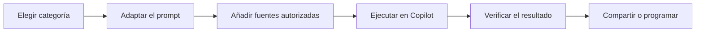

# Microsoft 365 Copilot Prompt Library

Biblioteca profesional en español para diseñar, implementar y gobernar prompts de Microsoft 365 Copilot.

> [!NOTE]
> Esta biblioteca está diseñada para GitHub, intranets Markdown y publicación editorial en SharePoint.

## Contenido

- **100 prompts** organizados en 10 categorías de trabajo.
- **24 tareas programadas** con frecuencias, ejemplos y controles de aprobación.
- Marco de prompting **OCFE**: objetivo, contexto, fuente y expectativas.
- Guías de seguridad, privacidad, gobierno y medición de impacto.
- Referencias oficiales de Microsoft.

## Formatos disponibles

| Formato | Punto de entrada | Uso recomendado |
|---|---|---|
| Documento único | [MICROSOFT_365_COPILOT_PROMPTS.md](MICROSOFT_365_COPILOT_PROMPTS.md) | Lectura o publicación en una sola página |
| Markdown multipágina | [intranet/markdown-multipage/README.md](intranet/markdown-multipage/README.md) | Sitios con navegación mediante archivos Markdown |
| SharePoint | [intranet/sharepoint/README.md](intranet/sharepoint/README.md) | Preparación de páginas modernas de Microsoft 365 |
| Tareas programadas | [intranet/markdown-multipage/13-tareas-programadas.md](intranet/markdown-multipage/13-tareas-programadas.md) | Automatización recurrente desde Copilot Chat y Task Hub |

## Inicio rápido

1. Consulte [Cómo diseñar un buen prompt](intranet/markdown-multipage/00-como-usar.md).
2. Seleccione una categoría desde la [portada multipágina](intranet/markdown-multipage/README.md).
3. Sustituya los campos entre corchetes.
4. Utilice únicamente fuentes autorizadas.
5. Verifique cifras, citas, fechas y compromisos antes de compartir resultados.

> [!TIP]
> Empiece con un prompt manual. Prográmelo únicamente después de comprobar que produce resultados útiles y consistentes.

## Uso responsable

Estas plantillas generan borradores, análisis y recomendaciones. Mantenga revisión humana para acciones sensibles, comunicaciones externas y decisiones legales, financieras, laborales o de cumplimiento.

> [!WARNING]
> No programe envíos, modificaciones de archivos o cambios de calendario sin aprobación humana explícita.

## Fuentes

La biblioteca se apoya principalmente en Microsoft Support, Microsoft Learn, Microsoft Adoption y Microsoft WorkLab. Consulte la [lista de fuentes oficiales](intranet/markdown-multipage/12-fuentes.md).

## Idioma y licencia

El contenido está redactado en español profesional. Antes de reutilizarlo públicamente o dentro de una organización, aplique las políticas internas de seguridad, privacidad, propiedad intelectual y uso responsable de IA.

## Sistema visual

Consulte [Sistema editorial Markdown](intranet/EDITORIAL_STYLE.md) para conocer los componentes, reglas y patrones visuales utilizados en el repositorio.
