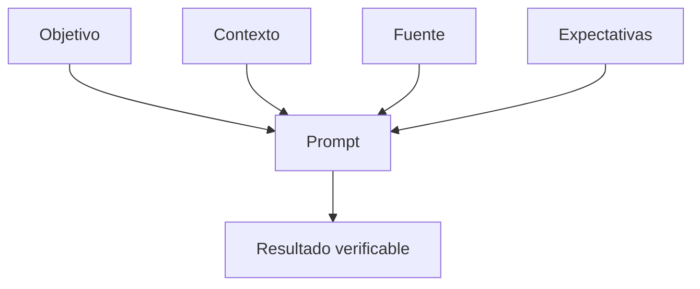

# Cómo diseñar un buen prompt

[← Volver a la portada](README.md) · [Primera categoría →](01-busqueda-sintesis.md)

> [!IMPORTANT]
> Un objetivo claro es obligatorio. Contexto, fuente y expectativas hacen que el resultado sea más preciso y verificable.

## El marco OCFE

Microsoft propone cuatro componentes para estructurar prompts:

| Componente | Pregunta | Ejemplo |
|---|---|---|
| **Objetivo** | ¿Qué debe hacer Copilot? | “Resume las decisiones…” |
| **Contexto** | ¿Para quién y con qué finalidad? | “…para un comité que no participó…” |
| **Fuente** | ¿Qué información debe utilizar? | “…usando el acta y el hilo de correo…” |
| **Expectativas** | ¿Cómo debe responder? | “…en una tabla con responsable y fecha.” |

## Plantilla maestra

```text
[OBJETIVO: acción y resultado].

Contexto: [audiencia, finalidad, situación, periodo y restricciones].
Fuentes: [archivos, correos, reuniones, chats, páginas o datos autorizados].
Expectativas: [formato, extensión, tono, criterios de calidad y orden].

Separa hechos, inferencias y datos faltantes. Incluye citas o referencias cuando estén disponibles. No inventes información; indica cualquier incertidumbre que deba revisar una persona.
```

## Sintaxis práctica

```text
Verbo + entregable + audiencia + propósito + fuente + periodo + restricciones + formato + control de calidad
```

## Antes de ejecutar

- Reemplace todos los campos entre `[corchetes]`.
- Adjunte o referencie solo las fuentes necesarias.
- Inicie una conversación nueva cuando cambie de asunto.
- No incluya datos sensibles sin autorización.
- Pida citas, supuestos y datos faltantes.
- Revise nombres, cifras, fechas y compromisos.

> [!TIP]
> Si el resultado no es suficiente, mejore una variable cada vez: fuente, periodo, audiencia, formato o criterio de calidad.

## Ejemplo completo

```text
Compara las propuestas de los proveedores para el comité de compras, usando
/Propuesta-A y /Propuesta-B. Evalúa precio, plazo, alcance, riesgos y exclusiones.
Devuelve una matriz comparativa, cita la fuente de cada dato y marca como
“No indicado” cualquier información ausente. No recomiendes una adjudicación.
```



---

[← Portada](README.md) · [Búsqueda y síntesis →](01-busqueda-sintesis.md)
