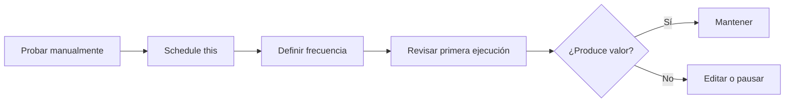

# Tareas programadas en Microsoft Copilot

[← Fuentes oficiales](12-fuentes.md) · [Portada](README.md)

Guía práctica para convertir prompts recurrentes en **Scheduled tasks** de Copilot: instrucciones que se ejecutan automáticamente en el día, hora y frecuencia configurados.


> [!NOTE]
> **Nombre actual de la función:** Microsoft está cambiando “Scheduled prompts” por **Scheduled tasks** y centralizando su gestión en **Task Hub**. La interfaz puede variar durante el despliegue.

## Disponibilidad y límites

Según Microsoft Support:

- Se requiere una licencia de Microsoft Copilot.
- La versión inicial funciona en **Copilot Chat**, en web o escritorio.
- Teams, Outlook y móvil no están incluidos en la versión inicial, aunque la tarea puede consultar datos de trabajo autorizados desde Copilot Chat.
- Puede crear una tarea desde un prompt mediante **Schedule this**, desde Copilot Chat o desde Task Hub.
- Puede ejecutar ahora, editar la programación, pausar o eliminar una tarea.
- Los resultados aparecen como conversaciones identificadas en la sección **Chats**.
- Copilot puede pedir aprobación antes de realizar acciones sensibles. En esta guía, las tareas preparan borradores y recomendaciones; no envían, eliminan ni modifican contenido automáticamente.

## Fórmula para una tarea programada

```text
CUÁNDO + QUÉ REVISAR + QUÉ RESULTADO PRODUCIR + QUÉ EXCLUIR + QUÉ REQUIERE APROBACIÓN
```

### Plantilla maestra

```text
Ejecuta esta tarea [frecuencia] a las [hora y zona horaria].

Objetivo: [resultado recurrente].
Revisa: [correos, reuniones, chats, archivos o fuentes autorizadas] del periodo [periodo].
Prioriza: [criterios].
Entrega: [formato, extensión, secciones y orden].
Excluye: [ruido, elementos completados, duplicados o fuentes no autorizadas].

Separa hechos, inferencias y datos faltantes. Incluye referencias cuando estén disponibles.
No envíes mensajes, no cambies calendarios, no edites archivos y no completes acciones sin mi aprobación explícita.
```

## Cómo crearla

1. Abra [Copilot Chat](https://m365.cloud.microsoft/chat) con su cuenta de Microsoft 365.
2. Pruebe el prompt manualmente una vez y revise el resultado.
3. Pase el cursor sobre el prompt y seleccione **Schedule this**, o cree la tarea desde Task Hub.
4. Defina día, hora y frecuencia.
5. Confirme la zona horaria y guarde.
6. Después de la primera ejecución, revise fuentes, cobertura y ruido.
7. Ajuste el prompt o pause la tarea si ya no produce valor.



---

## 1. Productividad personal diaria

### 1. Brief diario de trabajo

**Frecuencia sugerida:** días laborables, 08:00.

```text
Cada día laborable a las 8:00, prepara mi brief diario. Revisa el calendario de hoy, correos recibidos desde ayer, chats relevantes y compromisos pendientes accesibles. Entrega: 1) tres prioridades, 2) reuniones que requieren preparación, 3) fechas límite, 4) bloqueos y 5) acciones que debo completar. Excluye boletines, notificaciones automáticas y elementos ya completados. Incluye referencias. No envíes mensajes ni cambies mi calendario.
```

**Cómo aplicarlo:** úselo como primera revisión del día. Ajuste qué remitentes, proyectos o reuniones tienen prioridad.

### 2. Preparación de reuniones del día

**Frecuencia sugerida:** días laborables, 07:45.

```text
Cada día laborable a las 7:45, revisa mis reuniones de hoy. Para cada reunión, indica objetivo, participantes, documentos relacionados, decisiones pendientes, compromisos míos y preparación recomendada. Prioriza reuniones donde deba decidir, presentar o entregar algo. Marca como “Sin contexto suficiente” cualquier reunión sin fuentes. No cambies el calendario.
```

**Cómo aplicarlo:** asegúrese de que invitaciones, archivos y conversaciones tengan nombres consistentes.

### 3. Triage de mensajes pendientes

**Frecuencia sugerida:** días laborables, 09:00.

```text
Cada día laborable a las 9:00, revisa los correos y chats de trabajo recibidos desde la última ejecución. Clasifica únicamente los que requieren mi intervención en: responder hoy, decidir, delegar, esperar o leer. Para cada elemento, explica el criterio y propone el siguiente paso. No envíes respuestas ni marques mensajes como completados.
```

**Cómo aplicarlo:** añada nombres de proyectos o remitentes prioritarios para reducir ruido.

### 4. Cierre del día

**Frecuencia sugerida:** días laborables, 16:30.

```text
Cada día laborable a las 16:30, prepara un cierre de mi jornada. Resume decisiones, acciones completadas, compromisos nuevos y pendientes que vencen en los próximos cinco días laborables. Separa lo que debo hacer de lo que espero de otras personas. Excluye tareas cerradas. No envíes seguimientos; redacta borradores solo cuando exista un bloqueo o vencimiento.
```

**Cómo aplicarlo:** revise el resultado antes de terminar la jornada y reprograme tareas manualmente si corresponde.

---

## 2. Planificación semanal

### 5. Prioridades del lunes

**Frecuencia sugerida:** lunes, 08:00.

```text
Cada lunes a las 8:00, crea mi plan semanal usando el calendario, compromisos pendientes y archivos de proyectos activos. Propón máximo cinco resultados prioritarios, con fecha, dependencia, riesgo y primer paso. Distingue obligaciones confirmadas de recomendaciones. No añadas reuniones ni tareas automáticamente.
```

**Cómo aplicarlo:** defina en el prompt los proyectos que deben entrar o salir del análisis.

### 6. Revisión de compromisos del viernes

**Frecuencia sugerida:** viernes, 16:00.

```text
Cada viernes a las 16:00, revisa mis reuniones, correo y Teams de la semana. Separa: 1) compromisos que debo, 2) compromisos que otras personas me deben, 3) decisiones pendientes y 4) asuntos que pueden cerrarse. Excluye elementos completados. Prepara seguimientos breves para mi revisión, pero no los envíes.
```

**Cómo aplicarlo:** confirme responsables y fechas antes de usar cualquier borrador.

### 7. Agenda de las próximas dos semanas

**Frecuencia sugerida:** miércoles alternos, 16:00.

```text
Cada dos miércoles a las 16:00, revisa los próximos diez días laborables de mi calendario. Detecta conflictos, falta de preparación, entregables previos y reuniones sin objetivo claro. Propón bloques de preparación y alternativas de resolución, priorizando reuniones donde deba decidir o entregar. No cambies el calendario.
```

**Cómo aplicarlo:** es especialmente útil para roles con muchas reuniones y viajes.

### 8. Reserva de tiempo de concentración

**Frecuencia sugerida:** jueves, 15:00.

```text
Cada jueves a las 15:00, revisa mi calendario de la semana siguiente y mis cinco prioridades abiertas. Propón hasta tres bloques de concentración con duración, objetivo y motivo. Evita horarios ocupados y respeta `[restricciones horarias]`. No crees eventos; presenta la propuesta para mi aprobación.
```

**Cómo aplicarlo:** indique horas laborales, pausas y restricciones personales sin incluir información sensible innecesaria.

---

## 3. Proyectos y operaciones

### 9. Estado semanal de proyecto

**Frecuencia sugerida:** jueves, 14:00.

```text
Cada jueves a las 14:00, prepara el estado de `[proyecto]` usando `[sitio/carpeta]`, reuniones, correos y chats relacionados de los últimos siete días. Entrega: avance, decisiones, hitos, riesgos, bloqueos, dependencias y acciones con responsable y fecha. Cita fuentes y marca contradicciones. No declares completado nada sin evidencia.
```

**Cómo aplicarlo:** use nombres estables del proyecto y una ubicación documental definida.

### 10. Vigilancia de riesgos

**Frecuencia sugerida:** martes y jueves, 10:00.

```text
Cada martes y jueves a las 10:00, revisa las fuentes autorizadas de `[proyecto]` para detectar riesgos nuevos o cambios en riesgos existentes. Para cada uno indica evidencia, probabilidad cualitativa, impacto, señal temprana, propietario documentado y mitigación actual. Separa riesgos explícitos de inferencias. No cambies el registro de riesgos.
```

**Cómo aplicarlo:** el propietario del proyecto debe validar cada riesgo antes de registrarlo.

### 11. Fechas límite próximas

**Frecuencia sugerida:** días laborables, 08:30.

```text
Cada día laborable a las 8:30, identifica entregables y decisiones que vencen en los próximos cinco días laborables en `[proyectos]`. Muestra fecha, responsable documentado, dependencia, estado basado en evidencia y siguiente acción. Excluye elementos completados y no inventes fechas ausentes.
```

**Cómo aplicarlo:** funciona mejor cuando fechas y responsables están escritos en las fuentes.

### 12. Cambios en documentos críticos

**Frecuencia sugerida:** viernes, 11:00.

```text
Cada viernes a las 11:00, revisa los documentos críticos de `[ubicación]` modificados durante la semana. Resume cambios de alcance, fechas, cifras, obligaciones, responsables y riesgos. Cita versión o sección y marca cambios sin explicación. No edites ni restaure archivos.
```

**Cómo aplicarlo:** delimite la carpeta; no apunte a todo OneDrive o SharePoint.

---

## 4. Comunicación y partes interesadas

### 13. Borrador de actualización ejecutiva

**Frecuencia sugerida:** jueves, 15:30.

```text
Cada jueves a las 15:30, redacta una actualización ejecutiva de `[iniciativa]` usando información de los últimos siete días. Máximo 250 palabras: resultado, tres avances, decisiones, riesgo principal, ayuda necesaria y próximos hitos. Incluye referencias. No envíes el mensaje.
```

**Cómo aplicarlo:** defina audiencia y tono; revise información confidencial antes de compartir.

### 14. Seguimientos vencidos

**Frecuencia sugerida:** miércoles, 09:30.

```text
Cada miércoles a las 9:30, identifica compromisos documentados que otras personas debían completar y cuya fecha ya pasó. Excluye elementos resueltos. Prepara un borrador cordial por cada seguimiento con contexto, compromiso, fecha original y pregunta concreta. No envíes mensajes.
```

**Cómo aplicarlo:** valide que el compromiso y la fecha estén explícitos; no convierta inferencias en obligaciones.

### 15. Resumen para canal de equipo

**Frecuencia sugerida:** viernes, 14:00.

```text
Cada viernes a las 14:00, prepara un resumen para el canal de `[equipo]`: logros, decisiones, próximos hitos, ayuda solicitada y recordatorios. Usa solo fuentes del equipo de esta semana. Máximo 200 palabras. No publiques; entrega un borrador con referencias para revisión.
```

**Cómo aplicarlo:** sustituya el canal y las fuentes por ubicaciones autorizadas.

### 16. Preparación de comité

**Frecuencia sugerida:** el día laborable anterior, hora fija compatible con la recurrencia del comité.

```text
Cada `[día]` a las `[hora]`, prepara el brief para el comité de `[nombre]`. Resume decisiones pendientes, cambios desde la sesión anterior, métricas, riesgos y preguntas que requieren resolución. Usa `[fuentes]`, cita evidencia y limita el brief a una página. No presentes recomendaciones sin criterios explícitos.
```

**Cómo aplicarlo:** prográmelo según la recurrencia real del comité y no como disparador relativo a eventos si la interfaz no lo admite.

---

## 5. Conocimiento, aprendizaje y cumplimiento

### 17. Novedades de políticas internas

**Frecuencia sugerida:** primer día laborable del mes, 09:00.

```text
El primer día laborable de cada mes a las 9:00, revisa `[biblioteca de políticas]` y enumera documentos nuevos o modificados desde la última ejecución. Resume cambios, audiencia afectada, fecha de vigencia, propietario y acción requerida. No interpretes obligaciones legales; cita la sección exacta.
```

**Cómo aplicarlo:** use una biblioteca gobernada y confirme vigencia con Compliance o Legal.

### 18. Contenido pendiente de revisión

**Frecuencia sugerida:** primer lunes del mes, 10:00.

```text
El primer lunes de cada mes a las 10:00, revisa `[biblioteca]` para identificar contenido con revisión vencida, propietario ausente, enlaces rotos aparentes o conflicto con versiones más recientes. Propón una lista priorizada. No elimines, archives ni modifiques contenido.
```

**Cómo aplicarlo:** la obsolescencia debe confirmarla el propietario documental.

### 19. Digest de aprendizaje

**Frecuencia sugerida:** viernes, 12:00.

```text
Cada viernes a las 12:00, prepara un digest sobre `[tema profesional]`. Usa fuentes primarias publicadas durante los últimos siete días y material interno autorizado. Incluye cinco novedades, por qué importan, una aplicación práctica y enlaces. Separa información web de contenido interno.
```

**Cómo aplicarlo:** use búsqueda web solo si está autorizada por el tenant.

### 20. Revisión de decisiones antiguas

**Frecuencia sugerida:** último día laborable del mes, 14:00.

```text
El último día laborable de cada mes a las 14:00, revisa el registro de decisiones de `[equipo/proyecto]`. Identifica decisiones con fecha de revisión vencida, supuestos que cambiaron o acciones sin cierre documentado. Cita la evidencia y no reabra decisiones automáticamente.
```

**Cómo aplicarlo:** asegure que el registro tenga fechas y propietarios consistentes.

---

## 6. Liderazgo, clientes y actividad comercial

### 21. Preparación de reuniones individuales

**Frecuencia sugerida:** día fijo anterior a las reuniones individuales.

```text
Cada `[día]` a las `[hora]`, prepara mis reuniones individuales de la semana siguiente. Usa notas compartidas, compromisos explícitos y objetivos acordados. Para cada reunión, propone temas, preguntas abiertas y seguimientos. No infieras desempeño, actitud, emociones ni rasgos personales.
```

**Cómo aplicarlo:** limite la fuente a material compartido y autorizado.

### 22. Revisión de objetivos

**Frecuencia sugerida:** primer lunes del mes, 08:30.

```text
El primer lunes de cada mes a las 8:30, compara mis objetivos documentados con evidencia de avance del mes anterior. Para cada objetivo muestra resultado esperado, evidencia, brecha, dependencia y próxima acción. No evalúes mi desempeño ni inventes porcentajes de progreso.
```

**Cómo aplicarlo:** use objetivos con criterios medibles y fuentes identificables.

### 23. Preparación de cuentas o clientes

**Frecuencia sugerida:** lunes, 09:00.

```text
Cada lunes a las 9:00, revisa las reuniones de clientes de los próximos siete días. Para cada cuenta, resume contexto reciente, compromisos, temas abiertos, documentos relevantes y preparación requerida. Usa únicamente datos autorizados. No infieras intención de compra ni sentimiento del cliente.
```

**Cómo aplicarlo:** confirme que la información de cliente pueda tratarse en Copilot según política.

### 24. Oportunidades de seguimiento comercial

**Frecuencia sugerida:** viernes, 10:00.

```text
Cada viernes a las 10:00, revisa correos, reuniones y documentos autorizados relacionados con `[cuentas/propuestas]` durante los últimos 14 días. Identifica solicitudes explícitas, compromisos, fechas y preguntas sin respuesta. Prepara una lista priorizada y borradores de seguimiento. No envíes mensajes ni actualices sistemas.
```

**Cómo aplicarlo:** no trate señales ambiguas como oportunidades confirmadas.

---

## Plantillas reutilizables por frecuencia

### Plantilla diaria

```text
Cada día laborable a las [hora], revisa [fuentes] desde la última ejecución.
Identifica [criterios] y entrega [formato].
Excluye [ruido/completados]. Incluye referencias.
No realices acciones ni envíes mensajes sin mi aprobación.
```

### Plantilla semanal

```text
Cada [día] a las [hora], analiza los últimos siete días de [fuentes].
Resume [resultados], compara con [objetivo] y prioriza [criterios].
Entrega [estructura]. Distingue hechos, inferencias y datos faltantes.
```

### Plantilla mensual

```text
El [primer/último] día laborable de cada mes a las [hora], revisa [repositorio].
Identifica cambios desde la última ejecución en [campos].
Cita documentos y fechas. Propón acciones para revisión humana; no modifiques contenido.
```

### Plantilla de borrador con aprobación

```text
Cada [frecuencia], identifica [eventos o compromisos] en [fuentes].
Prepara borradores de [correo/mensaje/brief] con [tono y longitud].
No envíes, publiques ni cambies datos. Preséntame cada borrador y solicita aprobación explícita.
```

## Qué NO programar sin controles adicionales

> [!WARNING]
> No convierta comodidad en autonomía irreversible. Mantenga aprobación explícita para cualquier acción que envíe, elimine, publique o modifique contenido.

- Envío automático de correos o mensajes externos.
- Eliminación, movimiento o edición masiva de archivos.
- Cambios automáticos de calendario.
- Evaluaciones de desempeño o inferencias sobre personas.
- Decisiones legales, financieras, médicas, disciplinarias o de contratación.
- Publicación automática de cifras no verificadas.
- Tareas con fuentes demasiado amplias como “todos mis archivos”.

## Mantenimiento de tareas

Revise cada tarea después de la primera ejecución y, como mínimo, una vez al mes:

- ¿Sigue teniendo un propietario y una finalidad?
- ¿Las fuentes siguen siendo correctas y autorizadas?
- ¿Produce acciones útiles o solo más ruido?
- ¿La frecuencia sigue siendo adecuada?
- ¿Excluye elementos completados y duplicados?
- ¿Mantiene aprobación humana para acciones sensibles?

En Task Hub puede usar **Run now**, **Edit Schedule**, **Pause** y **Delete**.

## Fuentes oficiales

- Microsoft Support: [Updates to Scheduled Prompts in Copilot Chat](https://support.microsoft.com/en-us/microsoft-365-copilot/schedule-your-most-used-copilot-prompts)
- Microsoft Support: [Use Copilot Chat for long-running and multistep work](https://support.microsoft.com/en-us/microsoft-365-copilot/use-copilot-chat-for-long-running-multi-step-work)
- Microsoft Support: [Manage tasks and schedule prompts in Microsoft Copilot Cowork — Preview](https://support.microsoft.com/en-us/microsoft-365-copilot/cowork-manage-tasks-schedule-prompts)

---

[← Fuentes oficiales](12-fuentes.md) · [↑ Portada](README.md)
