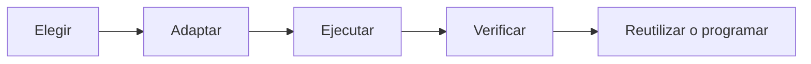

# Biblioteca de prompts para Microsoft 365 Copilot

Una biblioteca editorial de **100 prompts profesionales**, organizada por resultados de trabajo. Cada categoría contiene ejemplos listos para copiar, instrucciones de implementación y controles de calidad.

> [!TIP]
> **Empiece aquí:** lea [Cómo diseñar un buen prompt](00-como-usar.md) y luego elija una categoría.

> [!NOTE]
> **Automatización recurrente:** consulte [Tareas programadas en Microsoft Copilot](13-tareas-programadas.md) para configurar briefs diarios, revisiones semanales y seguimientos automáticos con aprobación humana.

## Explorar por categoría

| Categoría | Para qué sirve | Aplicaciones | Página |
|---|---|---|---|
| Búsqueda y síntesis | Encontrar, contrastar y resumir | Copilot Chat, Researcher | [Abrir](01-busqueda-sintesis.md) |
| Escritura y edición | Crear y mejorar documentos | Word | [Abrir](02-escritura-edicion.md) |
| Datos y decisiones | Analizar patrones y explicar resultados | Excel, Analyst | [Abrir](03-datos-decisiones.md) |
| Presentaciones | Construir narrativa visual | PowerPoint | [Abrir](04-presentaciones.md) |
| Correo y calendario | Reducir carga comunicativa | Outlook | [Abrir](05-correo-calendario.md) |
| Reuniones | Recuperar decisiones y acciones | Teams | [Abrir](06-reuniones.md) |
| Conocimiento colaborativo | Organizar notas e ideas | OneNote, Loop | [Abrir](07-conocimiento-colaborativo.md) |
| Encuestas | Diseñar recopilación estructurada | Forms | [Abrir](08-encuestas.md) |
| Gestión documental | Consultar y gobernar conocimiento | SharePoint, OneDrive | [Abrir](09-gestion-documental.md) |
| Planificación y automatización | Convertir resultados en ejecución | Planner, agentes | [Abrir](10-planificacion-automatizacion.md) |

## Ruta recomendada

1. **Defina el resultado**, no solo el tema.
2. **Seleccione las fuentes** mínimas y autorizadas.
3. **Copie un prompt** y sustituya los campos entre corchetes.
4. **Verifique la respuesta** antes de compartirla o ejecutar una acción.
5. Consulte [Implementación, seguridad y gobierno](11-implementacion-seguridad.md) antes de publicar una biblioteca corporativa.

## Recursos

- [Cómo diseñar un buen prompt](00-como-usar.md)
- [Implementación, seguridad y gobierno](11-implementacion-seguridad.md)
- [Fuentes oficiales de Microsoft](12-fuentes.md)
- [Tareas programadas: 24 ideas y plantillas](13-tareas-programadas.md)
- [Sistema editorial Markdown](../EDITORIAL_STYLE.md)
- [Versión completa en una sola página](../../MICROSOFT_365_COPILOT_PROMPTS.md)

---

**Versión:** 1.0 · **Actualización:** 23 de noviembre de 2026 · **Contenido:** 10 categorías y 100 prompts
