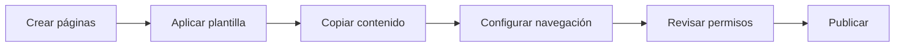

# Paquete editorial para SharePoint / Microsoft 365

Guía para convertir la biblioteca de prompts en un pequeño portal de páginas modernas de SharePoint, con navegación clara, contenido escaneable y mantenimiento sostenible.


> [!IMPORTANT]
> SharePoint no convierte automáticamente estos archivos Markdown en páginas modernas `.aspx`. Los archivos de `../markdown-multipage/` son el contenido editorial fuente que debe copiarse a los elementos web de texto o publicarse mediante el proceso corporativo autorizado.

## Resultado esperado

```text
Centro de IA y Copilot
└── Biblioteca de prompts
    ├── Cómo usar la biblioteca
    ├── Búsqueda y síntesis
    ├── Escritura y edición
    ├── Datos y decisiones
    ├── Presentaciones
    ├── Correo y calendario
    ├── Reuniones
    ├── Conocimiento colaborativo
    ├── Encuestas
    ├── Gestión documental
    ├── Planificación y automatización
    ├── Implementación y seguridad
    ├── Fuentes oficiales
    └── Tareas programadas
```

## Archivos del paquete

| Archivo | Uso |
|---|---|
| [Mapa del sitio](SITE_MAP.md) | Nombres, URL sugerida, fuente y orden de navegación |
| [Plantilla de página](PAGE_TEMPLATE.md) | Diseño editorial común para cada categoría |
| [Contenido de portada](PORTADA.md) | Texto listo para la página principal |
| [Fuentes multipágina](../markdown-multipage/README.md) | Contenido completo que alimenta cada página |

## Diseño de la portada

Use una página moderna con estas secciones:

1. **Hero de ancho completo**
   - Título: “Biblioteca de prompts para Microsoft 365 Copilot”.
   - Descripción: una frase de valor, sin texto comercial exagerado.
   - Acción principal: “Explorar categorías”.
   - Acción secundaria: “Aprender a crear prompts”.
2. **Accesos rápidos**
   - Diez vínculos agrupados en dos filas de cinco.
   - Use iconos consistentes; no mezcle fotografías e iconos.
3. **Cómo funciona**
   - Cuatro pasos: elegir, adaptar, ejecutar y verificar.
4. **Selección editorial**
   - Destaque máximo tres categorías, no diez tarjetas repetidas.
5. **Seguridad y ayuda**
   - Enlaces a gobierno, tareas programadas, fuentes y canal de soporte.
6. **Metadatos**
   - Propietario, última revisión y próxima revisión.

## Navegación recomendada

- **Navegación superior del sitio:** Portada · Cómo usar · Categorías · Seguridad · Fuentes.
- **Navegación local en cada página:** Anterior · Todas las categorías · Siguiente.
- **Pie de página:** Propietario · Última revisión · Solicitar cambio · Informar un error.
- Use páginas reales para categorías; no dependa de enlaces hacia títulos dentro de una sola página.

## Elementos web recomendados

| Necesidad | Elemento web |
|---|---|
| Presentación editorial | Texto |
| Categorías | Vínculos rápidos |
| Destacados | Hero, con máximo tres elementos |
| Navegación lateral | Vínculos rápidos compactos |
| Prompts | Texto con tablas simples o secciones plegables si la plantilla corporativa las admite |
| Propietario y revisión | Propiedades de página |
| Recursos relacionados | Contenido resaltado, si existe una biblioteca gobernada |

## Estilo editorial

- Fondo neutro y una sola paleta de acento corporativa.
- Una idea principal por sección.
- Títulos orientados a acciones: “Analizar datos”, no “Categoría 3”.
- Párrafos de dos a cuatro líneas.
- Tablas con máximo tres columnas en vistas estrechas.
- Frases completas y tono profesional, directo y neutral.
- Evite emojis en títulos y navegación corporativa.
- Use negrita para señales, no para párrafos enteros.
- Mantenga el prompt como bloque visual principal y la implementación como texto secundario.

## Metadatos de página

Configure columnas de sitio o propiedades equivalentes:

| Campo | Valor o tipo |
|---|---|
| Tipo de contenido | Guía de IA / Biblioteca de prompts |
| Categoría | Una de las diez categorías |
| Aplicación | Word, Excel, Teams, etc. |
| Propietario | Persona o grupo responsable |
| Estado | Borrador, En revisión, Publicado, Retirado |
| Última revisión | Fecha |
| Próxima revisión | Fecha |
| Sensibilidad | Según política corporativa |

## Flujo de publicación

1. Cree las páginas siguiendo [SITE_MAP.md](SITE_MAP.md).
2. Aplique una plantilla común basada en [PAGE_TEMPLATE.md](PAGE_TEMPLATE.md).
3. Copie el contenido desde `../markdown-multipage/`.
4. Sustituya enlaces `.md` por las URL `.aspx` definidas en el mapa.
5. Añada navegación local y propiedades de página.
6. Pruebe escritorio, móvil, búsqueda y permisos.
7. Envíe a revisión editorial, seguridad y propietario del contenido.
8. Publique y programe revisión trimestral.



> [!TIP]
> Publique primero una categoría piloto. Valide móvil, búsqueda y navegación antes de replicar la plantilla en todo el portal.

## Control de calidad

<details open>
<summary><strong>Ver checklist de publicación</strong></summary>

- [ ] Las 15 páginas del mapa existen.
- [ ] Los 10 enlaces de categoría funcionan.
- [ ] Cada categoría muestra exactamente 10 prompts.
- [ ] Anterior, inicio y siguiente funcionan en cada página.
- [ ] Las fuentes externas abren en una pestaña nueva según política.
- [ ] El contenido es legible en móvil.
- [ ] Propietario y fechas están visibles.
- [ ] Las páginas respetan permisos y etiquetas de sensibilidad.
- [ ] Existe un canal para informar errores o solicitar cambios.

</details>
